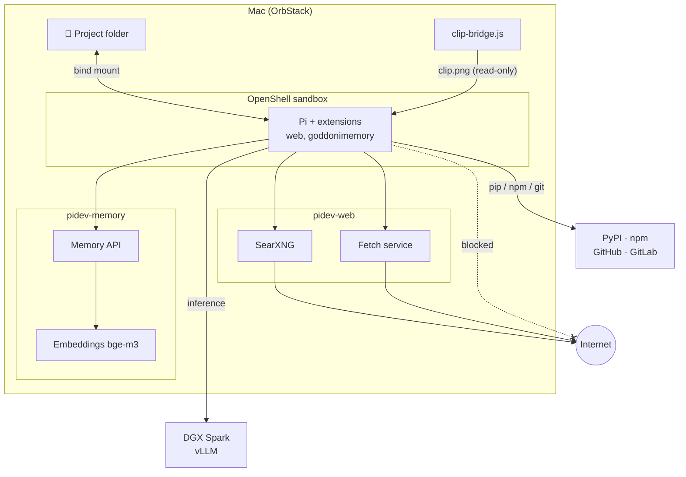
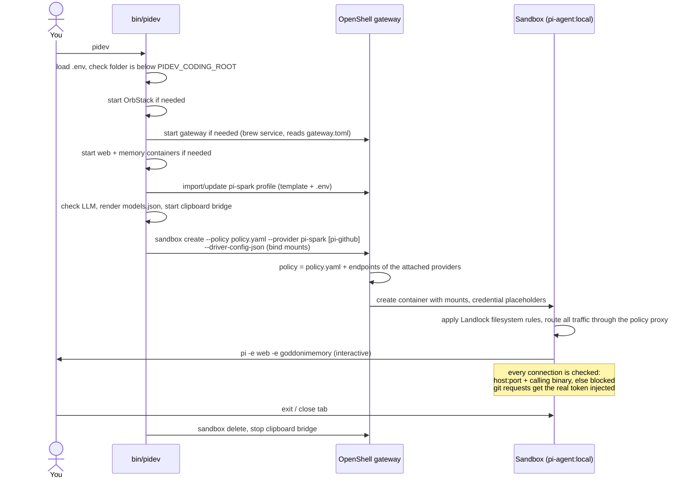

# pidev

Run the [Pi coding agent](https://www.npmjs.com/package/@earendil-works/pi-coding-agent) in an [NVIDIA OpenShell](https://github.com/NVIDIA/OpenShell) sandbox on a Mac, powered by a local LLM. One command per project; Pi sees only that project folder.

- **Local LLM:** vLLM on a DGX Spark (Qwen3.8 Flash-Next, vision capable)
- **Isolation:** Landlock filesystem + per-binary network policy, sandbox deleted on exit
- **Web:** own SearXNG meta search + fetch service (Readability → Markdown, SSRF guard)
- **Memory:** shared long-term memory, agent-driven only (hybrid full-text + semantic search)
- **Dev:** `pip` (venv), `npm`, `git` clone/push; tokens never enter the sandbox
- **Images:** paste screenshots with `Ctrl+V`



## Usage

```bash
cd ~/Coding/myproject && pidev   # existing project (below PIDEV_CODING_ROOT)
pinew myproject                  # new project (mkdir + git init)
```

`pidev` starts whatever is missing (OrbStack, OpenShell gateway, web and memory containers, clipboard bridge), checks the LLM and opens Pi. Pi can delete anything in the project folder, so always use git.

## How it works



- **Policies are not installed**, they are sent with every `sandbox create`: `policy.yaml` via `--policy`, provider profiles via `--provider`. Editing `policy.yaml` takes effect on the next `pidev`.
- **Provider profiles** live in the gateway (imported once, `pi-spark` by `pidev` itself). A provider adds its endpoints to the sandbox policy and holds its credentials outside the sandbox.
- **Gateway config** (`gateway.toml`) is read when the gateway starts and only allows the bind mounts.

## Layout

| Path | Purpose |
|---|---|
| `bin/` | `pidev`, `pinew` start scripts (put on `PATH`) |
| `Dockerfile.pi` | Sandbox image: Node 24, Pi, Python 3, git, extensions |
| `.env.example` | Local configuration template (project root, LLM endpoint, SearXNG secret) → `.env` |
| `models.json.template` | LLM provider for Pi, rendered with `.env` values on every start |
| `openshellPolicies/` | Sandbox policy, provider profiles, gateway config ([README](openshellPolicies/README.md)) |
| `extensions/web/` | Pi tools `web_search`, `web_fetch` |
| `extensions/goddonimemory/` | Pi tools `memory_*` |
| `web/` | SearXNG + fetch service (Docker Compose) |
| `memory/` | Memory API + embeddings (Docker Compose, [README](memory/README.md)) |
| `clipboard/` | Mac clipboard bridge + `xclip` shim for image paste |
| `gitconfig` | Git credential helper using the OpenShell token placeholder |

## Setup

Requirements: [OrbStack](https://orbstack.dev), an OpenAI-compatible LLM endpoint with tool calling.

1. Install OpenShell:
   `curl -LsSf https://raw.githubusercontent.com/NVIDIA/OpenShell/main/install.sh | OPENSHELL_VERSION=v0.1.7 sh`
2. Gateway config: copy `openshellPolicies/gateway.toml` to `~/.config/openshell/`, and in `~/.config/openshell/gateway.env` set `OPENSHELL_GATEWAY_CONFIG=$HOME/.config/openshell/gateway.toml`
3. Configure: `cp .env.example .env`, set project root and LLM endpoint, `SEARXNG_SECRET=$(openssl rand -hex 32)` (or just run `pidev` once, it creates `.env` with a secret)
4. Build and register (the LLM provider is registered by `pidev` itself):
   ```bash
   docker build -t pi-agent:local -f Dockerfile.pi .
   for p in pi-github pi-gitlab; do openshell provider profile import -f openshellPolicies/$p.yaml; done
   ```
5. Optional git push token (fine-grained, *Contents: read/write*):
   ```bash
   read -s "GITHUB_TOKEN?Token: " && GITHUB_TOKEN=$GITHUB_TOKEN openshell provider create --name pi-github --type pi-github --credential GITHUB_TOKEN; unset GITHUB_TOKEN
   ```
6. `export PATH="/path/to/pidev/bin:$PATH"` in `~/.zshrc`, then `brew services restart nvidia/openshell/openshell`
