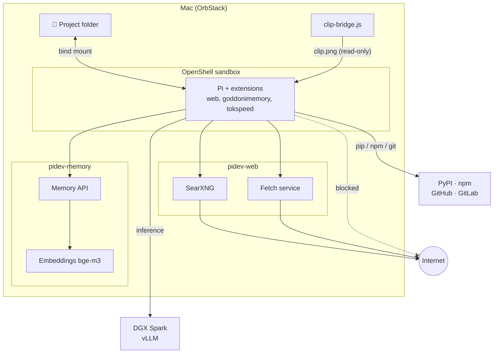
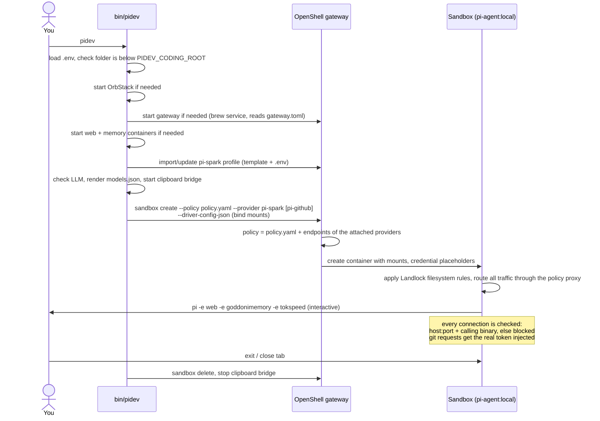

# pidev: a sandboxed, fully self-hosted AI coding agent

**Run an autonomous coding agent on your own hardware, with your own model, inside a sandbox that only lets it do what you've allowed.**


`pidev` wraps the [Pi coding agent](https://www.npmjs.com/package/@earendil-works/pi-coding-agent) in an [NVIDIA OpenShell](https://github.com/NVIDIA/OpenShell) sandbox and connects it to a local LLM, a private web search and a long-term memory service. One command per project:

```bash
cd ~/Coding/myproject && pidev
```

That command boots whatever infrastructure is missing, creates a fresh sandbox that can see **only this project folder**, and opens Pi. When you exit, the sandbox is deleted.

## Why

Cloud coding agents are convenient, but they send your code to a third party, and most local setups give the agent the same rights as your user account. I wanted both of these at once:

- **Nothing leaves my network unless I allow it.** Inference, web search and memory all run on my own hardware.
- **The agent can only do what I allow.** It gets real autonomy (installing packages, running code, pushing to git) inside tight, explicit limits.

## Highlights

| Feature | Details |
|---|---|
| **Local inference** | vLLM on an NVIDIA DGX Spark (Qwen3.8 Flash-Next, vision capable), OpenAI-compatible API. No per-token cost, and the code never leaves my network. |
| **Default-deny sandbox** | Landlock filesystem rules plus an allowlist network policy per binary and HTTP method. `python3` may read from PyPI, `node` from npm, `git` from GitHub. Everything else is blocked. |
| **Secrets stay outside** | Git tokens are placeholders inside the sandbox. The OpenShell proxy injects the real credential on the way out. |
| **Private web search** | Own SearXNG instance plus a fetch service (Readability → Markdown) with an SSRF guard, so the sandbox can't use it to reach the LAN. |
| **Long-term memory** | Shared across projects. Hybrid search (SQLite FTS5 + sqlite-vec, bge-m3 embeddings), duplicate detection, versioned soft deletes. The agent decides when to read and write. |
| **Performance HUD** | Live tokens/s, time to first token, session average and total response time in the footer. |
| **Screenshot paste** | `Ctrl+V` pastes images from the Mac clipboard into the sandboxed agent. |
| **Ephemeral** | A new sandbox on every start, deleted on exit. Policies are applied on every start, never installed. |

## Architecture



## Security model

Assume the agent will at some point do something you didn't intend, for example because of a prompt injection in a fetched web page. The question is how much damage it can do.

| Threat | Mitigation |
|---|---|
| Agent reads or deletes files outside the project | Landlock: read/write only on `/sandbox/project`, Pi's session folder and `/tmp`. The rest of the Mac is not mounted at all. |
| Agent sends data to an arbitrary server | Default-deny egress through the OpenShell policy proxy. Each rule is tied to a host, port **and calling binary**, and package registries are read-only (GET/HEAD). |
| Agent steals a git token | The token never enters the sandbox. Only a placeholder is visible, and the proxy swaps it in for requests to github.com / gitlab.com. |
| Agent uses the fetch service to reach the LAN (SSRF) | The fetch service resolves DNS itself, blocks private, loopback, link-local and multicast ranges, and re-checks every redirect hop. |
| Agent queries the embedding service directly | Not in the sandbox policy. Only the memory API may reach it. |
| Leftover state between sessions | The sandbox is created fresh and deleted on exit. Only the project folder and Pi's session history persist. |
| Agent wrecks the project folder | Not prevented. Always use git (`pinew` initializes a repo). |

Watch blocked requests live with `openshell term`. Details per file are in [openshellPolicies/README.md](openshellPolicies/README.md).

## How a session starts



Things worth knowing:

- **Policies are not installed.** They are sent with every `sandbox create`: `policy.yaml` via `--policy`, provider profiles via `--provider`. Editing `policy.yaml` takes effect on the next `pidev`.
- **Provider profiles** live in the gateway (imported once; `pi-spark` is managed by `pidev` itself). A provider adds its endpoints to the sandbox policy and holds its credentials outside the sandbox.
- **Gateway config** (`gateway.toml`) is read when the gateway starts and only enables the bind mounts.
- **Extensions are baked into the image** (`COPY` in `Dockerfile.pi`). Editing a file in `extensions/` has no effect until you rebuild `pi-agent:local` (see [Pi extensions](#pi-extensions)). Restarting the sandbox alone is not enough.

## Design decisions

- **The sandbox enforces the limits, not the agent.** Restrictions come from the kernel (Landlock) and the network proxy. They hold no matter what the model decides to do.
- **Per-binary network rules.** "Allow PyPI" is narrower when only `python3` may use that rule. A `node` script can't reach PyPI, and `curl` can't reach anything.
- **Own search and fetch instead of open internet.** The agent gets web access through two narrow, read-only HTTP APIs that I control, instead of a general egress rule.
- **Memory is a tool, not context.** Nothing is injected into the prompt automatically. The agent searches and saves explicitly, which keeps the context small and the memory curated (the API rejects near-duplicates and makes the agent update or replace them).
- **Extensions stay small.** Each extension is a single TypeScript file with no dependencies beyond Pi's own API. The performance HUD only takes timestamps on events, with no timers or polling, so it doesn't slow generation down.
- **Plain scripts over frameworks.** The orchestration is about 150 lines of zsh, so it's easy to read and debug.

## Tech stack

| Layer | Technology |
|---|---|
| Agent | Pi coding agent (Node 24), custom TypeScript extensions |
| Isolation | NVIDIA OpenShell (Landlock, policy proxy, credential providers), OrbStack / Docker |
| Inference | vLLM on NVIDIA DGX Spark, OpenAI-compatible API |
| Web | SearXNG, Node fetch service (Mozilla Readability, linkedom, Turndown) |
| Memory | FastAPI, SQLite (WAL, FTS5, sqlite-vec), llama.cpp with bge-m3 |
| Glue | zsh, Docker Compose, JXA (macOS clipboard bridge) |

## Usage

```bash
cd ~/Coding/myproject && pidev   # existing project (below PIDEV_CODING_ROOT)
pinew myproject                  # new project (mkdir + git init), then pidev
```

`pidev` starts whatever is missing (OrbStack, OpenShell gateway, web and memory containers, clipboard bridge), checks the LLM and opens Pi.

## Setup

Requirements: macOS with [OrbStack](https://orbstack.dev), an OpenAI-compatible LLM endpoint with tool calling.

1. Install OpenShell:
   `curl -LsSf https://raw.githubusercontent.com/NVIDIA/OpenShell/main/install.sh | OPENSHELL_VERSION=v0.1.7 sh`
2. Gateway config: copy `openshellPolicies/gateway.toml` to `~/.config/openshell/`, and in `~/.config/openshell/gateway.env` set `OPENSHELL_GATEWAY_CONFIG=$HOME/.config/openshell/gateway.toml`, plus `OPENSHELL_COMPUTE_DRIVER=docker` and `DOCKER_HOST=unix://$HOME/.orbstack/run/docker.sock`. Without these the gateway fails after a reboot, because `/var/run/docker.sock` may be missing and driver auto-detection finds no Docker.
3. Configure: `cp .env.example .env`, set project root and LLM endpoint, `SEARXNG_SECRET=$(openssl rand -hex 32)` (or just run `pidev` once, it creates `.env` with a secret)
4. Build and register (the LLM provider is registered by `pidev` itself):
   ```bash
   docker build -t pi-agent:local -f Dockerfile.pi .
   for p in pi-github pi-gitlab; do openshell provider profile import -f openshellPolicies/$p.yaml; done
   ```
5. Optional git push token (fine-grained, *Contents: read/write*):
   ```bash
   read -s "GITHUB_TOKEN?Token: " && GITHUB_TOKEN=$GITHUB_TOKEN openshell provider create --name pi-github --type pi-github --credential GITHUB_TOKEN; unset GITHUB_TOKEN
   ```
6. `export PATH="/path/to/pidev/bin:$PATH"` in `~/.zshrc`, then `brew services restart nvidia/openshell/openshell`

## Pi extensions

| Extension | What it adds |
|---|---|
| `web` | Tools `web_search` (SearXNG) and `web_fetch` (page → Markdown) |
| `goddonimemory` | Tools `memory_search`, `memory_save`, `memory_update`, `memory_forget`, command `/goddonimemory` ([details](memory/README.md)) |
| `tokspeed` | Footer HUD: tokens/s (live and exact), TTFT, session average, total response time |

Extensions live in `extensions/<name>/index.ts`. They are copied into the image at build time and loaded with `pi -e`.

**Change an existing extension:**

```bash
docker build -t pi-agent:local -f Dockerfile.pi .
```

Then quit any running Pi session and start `pidev` again (it creates a fresh sandbox from the new image).

**Add a new extension:**

1. Create `extensions/<name>/index.ts` (default export `function (pi: ExtensionAPI)`)
2. `Dockerfile.pi`: add `COPY extensions/<name> /usr/local/share/pi/extensions/<name>`
3. `bin/pidev`: append `-e /usr/local/share/pi/extensions/<name>` to the `pi` command
4. Rebuild the image (see above) and restart `pidev`
5. README: add the extension to the tables and diagrams

Check that the image contains the current version:

```bash
docker run --rm --entrypoint cat pi-agent:local /usr/local/share/pi/extensions/<name>/index.ts
```

## Repository layout

| Path | Purpose |
|---|---|
| `bin/` | `pidev`, `pinew` start scripts (put on `PATH`) |
| `Dockerfile.pi` | Sandbox image: Node 24, Pi, Python 3, git, extensions |
| `.env.example` | Local configuration template (project root, LLM endpoint, SearXNG secret) → `.env` |
| `models.json.template` | LLM provider for Pi, rendered with `.env` values on every start |
| `openshellPolicies/` | Sandbox policy, provider profiles, gateway config ([README](openshellPolicies/README.md)) |
| `extensions/` | Pi extensions `web`, `goddonimemory`, `tokspeed` |
| `web/` | SearXNG + fetch service (Docker Compose) |
| `memory/` | Memory API + embeddings (Docker Compose, [README](memory/README.md)) |
| `clipboard/` | Mac clipboard bridge + `xclip` shim for image paste |
| `gitconfig` | Git credential helper using the OpenShell token placeholder |

## Limitations

- macOS only (OrbStack, JXA clipboard bridge, `zsh` scripts).
- Built around my hardware: one DGX Spark for inference. Any OpenAI-compatible endpoint with tool calling works, but quality depends on the model.
- The agent has full write access to the project folder. The sandbox protects everything else, but git is your undo button.

## License

[MIT](LICENSE)
